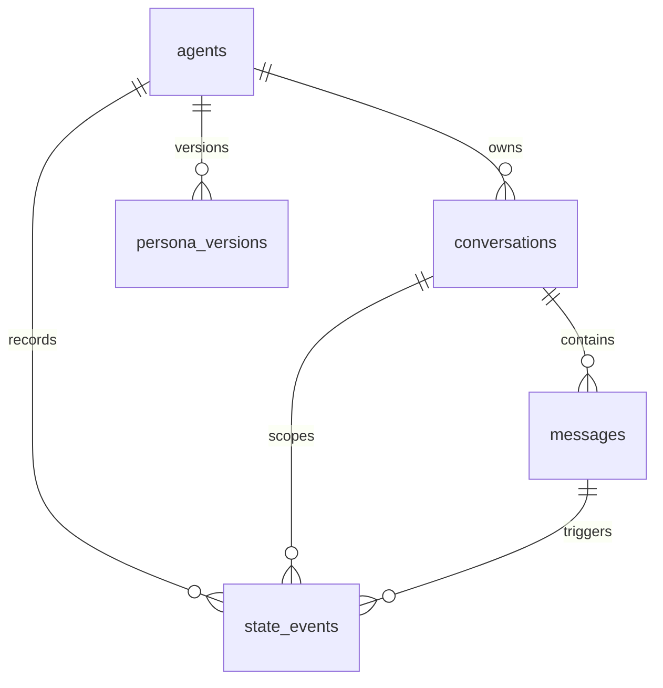

# SQLite 数据库结构设计

项目：本地单用户拟人化聊天 Agent  
关联文档：[requirements.md](./requirements.md)、[technical-design.md](./technical-design.md)  
数据库：SQLite  
ORM：Drizzle ORM  
版本：v1.1  
日期：2026-11-11

---

## 1. 设计范围

本文档定义 Phase 0 / MVP 需要创建的 SQLite 表结构、约束、索引、迁移顺序和初始化数据。

初始迁移只包含：

```text
agents
conversations
messages
state_events
persona_versions
app_settings
```

Phase 2 及以后的表不进入初始迁移，包括：

```text
memories
conversation_summaries
persona_proposals
prompt_snapshots
```

原因是这些模块的详细行为尚未进入实现阶段，提前建表容易造成错误抽象。当前 schema 只保证不阻碍后续扩展。

---

## 2. 数据库设计原则

1. **SQLite 是唯一事实来源**  
   浏览器 localStorage 不保存消息、状态和人格事实，只可作为临时 UI 缓存。

2. **所有 Agent 相关数据从第一版开始携带 `agent_id`**  
   当前只有一个默认 Agent，但结构必须支持未来多 Agent / 多人格。

3. **消息永不因超出上下文窗口而删除**  
   超出近期窗口的消息只是不进入 Prompt，仍保留在 `messages`。

4. **状态事件不可变**  
   当前状态快照保存在 `agents`，完整变化链路保存在 `state_events`。

5. **人格版本不可物理覆盖**  
   `persona_versions` 只插入新版本，不更新旧版本内容。

6. **本地单用户当前使用固定 `user_id`**  
   当前固定为：

   ```text
   local-user
   ```

   暂不实现用户表和账号系统。

7. **时间统一使用 ISO 8601 UTC 字符串**  
   示例：

   ```text
   2026-11-11T08:30:00.000Z
   ```

8. **软删除暂不引入**  
   MVP 没有删除功能。未来实现记忆删除时会补充删除策略，不允许随意使用软删除字段污染当前模型。

---

## 3. 实体关系总览



说明：

- 一个 Agent 可以有多个会话；
- 一个会话有多条消息；
- 一条用户消息可能触发一条状态事件；
- 一个 Agent 可以有多个人格版本；
- 当前 MVP 通常只复用最近活跃会话，暂不做会话列表 UI。

---

## 4. 通用字段约定

## 4.1 主键

所有表使用文本 UUID 作为主键：

```text
id TEXT PRIMARY KEY
```

推荐前缀：

| 表 | ID 前缀 |
|---|---|
| `agents` | `agent_` |
| `conversations` | `conv_` |
| `messages` | `msg_` |
| `state_events` | `state_` |
| `persona_versions` | `persona_` |
| `app_settings` | 无，主键为 `key` |

示例：

```text
msg_018f6d2e-8fb4-7a1e-9f0f-4c1f7a9d0001
```

可以使用 UUID v7；如果生成库不支持，UUID v4 也可接受。

---

## 4.2 时间字段

统一格式：

```text
TEXT NOT NULL
```

存储 ISO 8601 UTC。

字段：

- `created_at`：记录创建时间；
- `updated_at`：记录最后更新时间；
- 业务时间如 `last_message_at`、`state_updated_at` 同样使用该格式。

应用层要求：

- 服务端生成；
- 不信任前端传入的时间作为业务事实；
- 查询排序可使用字符串排序，因为 UTC ISO 格式具有字典序一致性。

---

## 4.3 数值范围

情感相关字段使用 `REAL`：

```text
valence: -1 到 1
arousal: -1 到 1
confidence: 0 到 1
```

数据库层使用 `CHECK` 约束兜底，应用层仍必须先校验和 clamp。

---

## 4.4 JSON 字段

MVP 中的 JSON 字段使用 `TEXT` 保存 JSON 字符串。

示例：

```text
metadata_json
evolvable_json
value_json
```

约束：

```sql
CHECK (field IS NULL OR json_valid(field))
```

要求：

- 只保存可序列化 JSON；
- 不在 SQL 中解析复杂业务语义；
- TypeScript 侧用共享 schema 校验；
- 未来需要高频查询的 JSON 字段应提升为独立列。

---

## 4.5 布尔字段

SQLite 不使用 BOOLEAN 类型，统一使用：

```text
INTEGER 0 / 1
```

例如：

```text
is_archived
is_active
```

---

## 5. 表结构详细设计

## 5.1 `agents`

### 用途

保存 Agent 实例、当前状态快照和当前人格版本指针。

### 字段表

| 字段 | SQLite 类型 | 约束 | 说明 |
|---|---|---|---|
| `id` | `TEXT` | `PRIMARY KEY` | Agent ID |
| `slug` | `TEXT` | `NOT NULL UNIQUE` | 稳定标识，如 `default` |
| `display_name` | `TEXT` | `NOT NULL` | UI 展示名 |
| `description` | `TEXT` | 可空 | Agent 简介 |
| `current_valence` | `REAL` | `NOT NULL`，范围 -1 到 1 | 当前愉悦度快照 |
| `current_arousal` | `REAL` | `NOT NULL`，范围 -1 到 1 | 当前唤醒度快照 |
| `current_tag` | `TEXT` | `NOT NULL` | 当前离散情感标签 |
| `state_updated_at` | `TEXT` | 可空 | 状态快照更新时间 |
| `active_persona_version` | `INTEGER` | `NOT NULL` | 当前人格版本号 |
| `created_at` | `TEXT` | `NOT NULL` | 创建时间 |
| `updated_at` | `TEXT` | `NOT NULL` | 更新时间 |

### 约束说明

`current_tag` 允许值：

```text
calm
curious
happy
low
tense
neutral
```

`active_persona_version` 逻辑上指向：

```text
persona_versions(agent_id, version)
```

由于 `agents` 与 `persona_versions` 存在相互引用，为避免循环外键导致迁移复杂化，初始 schema 不在 `agents.active_persona_version` 上建立数据库级外键，而由应用层在事务中维护一致性。

后续如果重构为 `agent_active_persona` 关联表，可以再引入严格外键。

### DDL

```sql
CREATE TABLE agents (
  id TEXT PRIMARY KEY,

  slug TEXT NOT NULL UNIQUE,
  display_name TEXT NOT NULL,
  description TEXT,

  current_valence REAL NOT NULL CHECK (
    current_valence >= -1 AND current_valence <= 1
  ),

  current_arousal REAL NOT NULL CHECK (
    current_arousal >= -1 AND current_arousal <= 1
  ),

  current_tag TEXT NOT NULL CHECK (
    current_tag IN (
      'calm',
      'curious',
      'happy',
      'low',
      'tense',
      'neutral'
    )
  ),

  state_updated_at TEXT,

  active_persona_version INTEGER NOT NULL CHECK (
    active_persona_version >= 1
  ),

  created_at TEXT NOT NULL,
  updated_at TEXT NOT NULL
);
```

### 索引

```sql
CREATE UNIQUE INDEX agents_slug_idx
  ON agents (slug);
```

`slug` 已有 `UNIQUE` 约束时该索引可以省略；为了迁移可读性，也可以显式保留。

---

## 5.2 `conversations`

### 用途

保存一次连续对话。

### 字段表

| 字段 | SQLite 类型 | 约束 | 说明 |
|---|---|---|---|
| `id` | `TEXT` | `PRIMARY KEY` | 会话 ID |
| `user_id` | `TEXT` | `NOT NULL` | 当前固定为 `local-user` |
| `agent_id` | `TEXT` | `NOT NULL FK` | 所属 Agent |
| `title` | `TEXT` | 可空 | 会话标题 |
| `last_message_at` | `TEXT` | 可空 | 最近消息时间 |
| `is_archived` | `INTEGER` | `NOT NULL DEFAULT 0` | 是否归档 |
| `created_at` | `TEXT` | `NOT NULL` | 创建时间 |
| `updated_at` | `TEXT` | `NOT NULL` | 更新时间 |

### 外键

```text
agent_id → agents.id
```

删除策略：

```text
ON DELETE RESTRICT
```

不允许直接删除仍拥有会话的 Agent。未来数据删除必须先处理子表。

### DDL

```sql
CREATE TABLE conversations (
  id TEXT PRIMARY KEY,

  user_id TEXT NOT NULL,
  agent_id TEXT NOT NULL,

  title TEXT,
  last_message_at TEXT,
  is_archived INTEGER NOT NULL DEFAULT 0 CHECK (
    is_archived IN (0, 1)
  ),

  created_at TEXT NOT NULL,
  updated_at TEXT NOT NULL,

  FOREIGN KEY (agent_id)
    REFERENCES agents (id)
    ON DELETE RESTRICT
);
```

### 索引

```sql
CREATE INDEX conversations_agent_last_message_idx
  ON conversations (agent_id, last_message_at DESC);

CREATE INDEX conversations_user_agent_idx
  ON conversations (user_id, agent_id);
```

说明：

- 当前本地单用户 `user_id` 查询频率不高，但保留字段和索引是为未来数据隔离做准备；
- `conversations_agent_last_message_idx` 用于查找最近活跃会话。

---

## 5.3 `messages`

### 用途

保存用户、Assistant 和系统消息。消息是长期持久化数据，超出 Prompt 窗口也不删除。

### 字段表

| 字段 | SQLite 类型 | 约束 | 说明 |
|---|---|---|---|
| `id` | `TEXT` | `PRIMARY KEY` | 服务端消息 ID |
| `conversation_id` | `TEXT` | `NOT NULL FK` | 所属会话 |
| `agent_id` | `TEXT` | `NOT NULL FK` | 所属 Agent |
| `user_id` | `TEXT` | `NOT NULL` | 所属本地用户 |
| `role` | `TEXT` | `NOT NULL` | 消息角色 |
| `content` | `TEXT` | `NOT NULL` | 纯文本内容 |
| `status` | `TEXT` | `NOT NULL` | 消息状态 |
| `client_message_id` | `TEXT` | 可空 | 前端幂等 ID |
| `error_code` | `TEXT` | 可空 | 失败码 |
| `metadata_json` | `TEXT` | 可空 | 扩展元数据 |
| `created_at` | `TEXT` | `NOT NULL` | 创建时间 |
| `updated_at` | `TEXT` | `NOT NULL` | 更新时间 |

### 枚举值

`role`：

```text
user
assistant
system
```

`status`：

```text
streaming
complete
failed
```

### 关键约束

1. 用户消息必须有 `client_message_id`：

```sql
CHECK (
  role <> 'user'
  OR client_message_id IS NOT NULL
)
```

2. 同一会话内 `client_message_id` 唯一：

```sql
UNIQUE (conversation_id, client_message_id)
```

3. 失败消息必须有 `error_code`：

```sql
CHECK (
  status <> 'failed'
  OR error_code IS NOT NULL
)
```

### 外键

```text
conversation_id → conversations.id ON DELETE RESTRICT
agent_id        → agents.id        ON DELETE RESTRICT
```

### DDL

```sql
CREATE TABLE messages (
  id TEXT PRIMARY KEY,

  conversation_id TEXT NOT NULL,
  agent_id TEXT NOT NULL,
  user_id TEXT NOT NULL,

  role TEXT NOT NULL CHECK (
    role IN ('user', 'assistant', 'system')
  ),

  content TEXT NOT NULL,

  status TEXT NOT NULL CHECK (
    status IN ('streaming', 'complete', 'failed')
  ),

  client_message_id TEXT,
  error_code TEXT,
  metadata_json TEXT CHECK (
    metadata_json IS NULL OR json_valid(metadata_json)
  ),

  created_at TEXT NOT NULL,
  updated_at TEXT NOT NULL,

  CHECK (
    role <> 'user'
    OR client_message_id IS NOT NULL
  ),

  CHECK (
    status <> 'failed'
    OR error_code IS NOT NULL
  ),

  UNIQUE (conversation_id, client_message_id),

  FOREIGN KEY (conversation_id)
    REFERENCES conversations (id)
    ON DELETE RESTRICT,

  FOREIGN KEY (agent_id)
    REFERENCES agents (id)
    ON DELETE RESTRICT
);
```

### 索引

```sql
CREATE INDEX messages_conversation_created_idx
  ON messages (conversation_id, created_at DESC);

CREATE INDEX messages_agent_created_idx
  ON messages (agent_id, created_at DESC);

CREATE INDEX messages_status_idx
  ON messages (status);
```

### 索引用途

| 索引 | 用途 |
|---|---|
| `messages_conversation_created_idx` | 会话恢复、分页、近期窗口 |
| `messages_agent_created_idx` | 未来跨会话检索、调试 |
| `messages_status_idx` | 查找 streaming 或 failed 异常消息 |

### 状态流转

```text
user:
  插入时即为 complete

assistant:
  streaming → complete
  streaming → failed
```

不允许：

```text
complete → streaming
failed → complete
```

如果需要重新生成，应插入新的 Assistant 消息或建立 generation 表，不在当前 MVP 中复用旧消息。

---

## 5.4 `state_events`

### 用途

保存不可变的状态变化事件。当前状态快照在 `agents`，完整历史在 `state_events`。

### 字段表

| 字段 | SQLite 类型 | 约束 | 说明 |
|---|---|---|---|
| `id` | `TEXT` | `PRIMARY KEY` | 状态事件 ID |
| `agent_id` | `TEXT` | `NOT NULL FK` | 所属 Agent |
| `conversation_id` | `TEXT` | `NOT NULL FK` | 事件发生时会话 |
| `trigger_message_id` | `TEXT` | 可空 FK | 触发消息 |
| `source` | `TEXT` | `NOT NULL` | 事件来源 |
| `rule_version` | `TEXT` | `NOT NULL` | 状态规则版本 |
| `before_valence` | `REAL` | `NOT NULL` | 变化前愉悦度 |
| `before_arousal` | `REAL` | `NOT NULL` | 变化前唤醒度 |
| `delta_valence` | `REAL` | `NOT NULL` | 愉悦度变化 |
| `delta_arousal` | `REAL` | `NOT NULL` | 唤醒度变化 |
| `after_valence` | `REAL` | `NOT NULL` | 变化后愉悦度 |
| `after_arousal` | `REAL` | `NOT NULL` | 变化后唤醒度 |
| `discrete_tag` | `TEXT` | `NOT NULL` | 离散情感标签 |
| `reason` | `TEXT` | `NOT NULL` | UI 展示原因 |
| `evidence_text` | `TEXT` | `NOT NULL` | 触发证据 |
| `confidence` | `REAL` | `NOT NULL` | 置信度 |
| `created_at` | `TEXT` | `NOT NULL` | 事件时间 |

### 枚举值

`source`：

```text
user_message
assistant_message
time_decay
manual
```

MVP 只使用：

```text
user_message
```

### 关键约束

1. 数值范围：

```text
before_valence / after_valence: -1 到 1
before_arousal / after_arousal: -1 到 1
delta_valence / delta_arousal: -1 到 1
confidence: 0 到 1
```

2. `user_message` 与 `assistant_message` 来源必须有触发消息：

```sql
CHECK (
  source NOT IN ('user_message', 'assistant_message')
  OR trigger_message_id IS NOT NULL
)
```

3. 幂等唯一约束：

```sql
UNIQUE (
  trigger_message_id,
  source,
  rule_version
)
```

由于 SQLite 对 `NULL` 参与唯一约束的处理较宽松，该约束主要保护由消息触发的事件，正好符合 MVP 需求。

### 外键

```text
agent_id        → agents.id        ON DELETE RESTRICT
conversation_id → conversations.id ON DELETE RESTRICT
trigger_message_id → messages.id   ON DELETE RESTRICT
```

### DDL

```sql
CREATE TABLE state_events (
  id TEXT PRIMARY KEY,

  agent_id TEXT NOT NULL,
  conversation_id TEXT NOT NULL,
  trigger_message_id TEXT,

  source TEXT NOT NULL CHECK (
    source IN (
      'user_message',
      'assistant_message',
      'time_decay',
      'manual'
    )
  ),

  rule_version TEXT NOT NULL,

  before_valence REAL NOT NULL CHECK (
    before_valence >= -1 AND before_valence <= 1
  ),

  before_arousal REAL NOT NULL CHECK (
    before_arousal >= -1 AND before_arousal <= 1
  ),

  delta_valence REAL NOT NULL CHECK (
    delta_valence >= -1 AND delta_valence <= 1
  ),

  delta_arousal REAL NOT NULL CHECK (
    delta_arousal >= -1 AND delta_arousal <= 1
  ),

  after_valence REAL NOT NULL CHECK (
    after_valence >= -1 AND after_valence <= 1
  ),

  after_arousal REAL NOT NULL CHECK (
    after_arousal >= -1 AND after_arousal <= 1
  ),

  discrete_tag TEXT NOT NULL CHECK (
    discrete_tag IN (
      'calm',
      'curious',
      'happy',
      'low',
      'tense',
      'neutral'
    )
  ),

  reason TEXT NOT NULL,
  evidence_text TEXT NOT NULL,

  confidence REAL NOT NULL CHECK (
    confidence >= 0 AND confidence <= 1
  ),

  created_at TEXT NOT NULL,

  CHECK (
    source NOT IN ('user_message', 'assistant_message')
    OR trigger_message_id IS NOT NULL
  ),

  UNIQUE (trigger_message_id, source, rule_version),

  FOREIGN KEY (agent_id)
    REFERENCES agents (id)
    ON DELETE RESTRICT,

  FOREIGN KEY (conversation_id)
    REFERENCES conversations (id)
    ON DELETE RESTRICT,

  FOREIGN KEY (trigger_message_id)
    REFERENCES messages (id)
    ON DELETE RESTRICT
);
```

### 索引

```sql
CREATE INDEX state_events_agent_created_idx
  ON state_events (agent_id, created_at DESC);

CREATE INDEX state_events_conversation_created_idx
  ON state_events (conversation_id, created_at DESC);

CREATE INDEX state_events_trigger_idx
  ON state_events (trigger_message_id);
```

### 更新规则

`state_events` 不允许 `UPDATE` 业务字段，只允许插入。

当前状态快照更新流程必须在同一事务中完成：

```text
1. 查询 agents 当前状态
2. 计算新状态
3. 插入 state_events
4. 更新 agents.current_valence / current_arousal / current_tag / state_updated_at
5. 提交事务
```

并发场景下应使用写事务保证状态事件顺序。

---

## 5.5 `persona_versions`

### 用途

保存 Agent 的人格版本。人格锚点不可被 LLM 或普通聊天消息修改。

### 字段表

| 字段 | SQLite 类型 | 约束 | 说明 |
|---|---|---|---|
| `id` | `TEXT` | `PRIMARY KEY` | 版本记录 ID |
| `agent_id` | `TEXT` | `NOT NULL FK` | 所属 Agent |
| `version` | `INTEGER` | `NOT NULL` | 版本号，从 1 开始 |
| `persona_core_md` | `TEXT` | `NOT NULL` | 固定人格锚点 |
| `persona_core_hash` | `TEXT` | `NOT NULL` | 人格锚点 hash |
| `evolvable_json` | `TEXT` | `NOT NULL` | 可演化片段 JSON |
| `is_active` | `INTEGER` | `NOT NULL DEFAULT 0` | 是否当前版本 |
| `created_at` | `TEXT` | `NOT NULL` | 创建时间 |
| `activated_at` | `TEXT` | 可空 | 生效时间 |

### 关键约束

```text
UNIQUE (agent_id, version)
```

MVP 只允许一条 active version。由于 SQLite 迁移和 ORM 对部分唯一索引的支持需要谨慎处理，当前用应用层事务保证：

```text
同一 agent_id 下只能有一条 is_active = 1
```

后续如果需要严格数据库约束，可添加迁移：

```sql
CREATE UNIQUE INDEX persona_versions_one_active_idx
  ON persona_versions (agent_id)
  WHERE is_active = 1;
```

该部分唯一索引是推荐增强项，是否启用取决于最终 Drizzle 迁移能力，不影响逻辑设计。

### 外键

```text
agent_id → agents.id ON DELETE RESTRICT
```

### DDL

```sql
CREATE TABLE persona_versions (
  id TEXT PRIMARY KEY,

  agent_id TEXT NOT NULL,
  version INTEGER NOT NULL CHECK (version >= 1),

  persona_core_md TEXT NOT NULL,
  persona_core_hash TEXT NOT NULL,

  evolvable_json TEXT NOT NULL CHECK (
    json_valid(evolvable_json)
  ),

  is_active INTEGER NOT NULL DEFAULT 0 CHECK (
    is_active IN (0, 1)
  ),

  created_at TEXT NOT NULL,
  activated_at TEXT,

  UNIQUE (agent_id, version),

  FOREIGN KEY (agent_id)
    REFERENCES agents (id)
    ON DELETE RESTRICT
);
```

### 索引

```sql
CREATE INDEX persona_versions_agent_version_idx
  ON persona_versions (agent_id, version DESC);
```

### MVP 初始化规则

只创建 version 1：

```text
version = 1
is_active = 1
activated_at = now
```

不允许出现多个 active 版本。

---

## 5.6 `app_settings`

### 用途

保存本地键值配置。

### 字段表

| 字段 | SQLite 类型 | 约束 | 说明 |
|---|---|---|---|
| `key` | `TEXT` | `PRIMARY KEY` | 设置键 |
| `value_json` | `TEXT` | `NOT NULL` | JSON 值 |
| `updated_at` | `TEXT` | `NOT NULL` | 更新时间 |

### DDL

```sql
CREATE TABLE app_settings (
  key TEXT PRIMARY KEY,

  value_json TEXT NOT NULL CHECK (
    json_valid(value_json)
  ),

  updated_at TEXT NOT NULL
);
```

### MVP 初始键

| key | 类型 | 默认值 | 说明 |
|---|---|---|---|
| `default_agent_id` | string | `"agent-default"` | 默认 Agent |
| `recent_window_rounds` | number | `15` | 近期窗口轮数 |
| `max_context_messages` | number | `30` | 进入 Prompt 的最大消息数 |
| `theme` | string | `"system"` | UI 主题 |

`value_json` 示例：

```json
"agent-default"
```

```json
15
```

不要保存：

```json
{"value": 15}
```

键本身已经表达语义，值直接保存 JSON 标量。

### 校验规则

| key | 规则 |
|---|---|
| `default_agent_id` | 必须存在于 `agents.id`，应用层校验 |
| `recent_window_rounds` | 10 到 15 |
| `max_context_messages` | 20 到 30，且等于 `recent_window_rounds * 2` |
| `theme` | `light` / `dark` / `system` |

---

## 6. 初始数据

首次启动时，在一个事务中执行初始化。

假设：

```text
now = 当前 ISO 8601 UTC 时间
```

### 6.1 默认 Agent

```sql
INSERT INTO agents (
  id,
  slug,
  display_name,
  description,
  current_valence,
  current_arousal,
  current_tag,
  state_updated_at,
  active_persona_version,
  created_at,
  updated_at
)
VALUES (
  'agent-default',
  'default',
  'Aiko',
  NULL,
  0.0,
  0.0,
  'neutral',
  NULL,
  1,
  :now,
  :now
);
```

`display_name` 可在实现前调整，但 `id` 和 `slug` 建议保持稳定。

### 6.2 人格版本 1

```sql
INSERT INTO persona_versions (
  id,
  agent_id,
  version,
  persona_core_md,
  persona_core_hash,
  evolvable_json,
  is_active,
  created_at,
  activated_at
)
VALUES (
  :persona_version_id,
  'agent-default',
  1,
  :persona_core_md,
  :persona_core_hash,
  :initial_evolvable_json,
  1,
  :now,
  :now
);
```

`:persona_core_md` 与 `:initial_evolvable_json` 的唯一来源是 [persona-core-v1.md](./persona-core-v1.md)，seed 脚本必须从该文件标记区读取内容，不得在代码中维护第二份副本。

`persona_core_hash` 计算：

```text
SHA-256(persona_core_md)
```

建议使用 UTF-8 bytes 计算，并保存十六进制小写：

```text
64 个字符
```

### 6.3 设置

```sql
INSERT INTO app_settings (
  key,
  value_json,
  updated_at
)
VALUES
  ('default_agent_id', '"agent-default"', :now),
  ('recent_window_rounds', '15', :now),
  ('max_context_messages', '30', :now),
  ('theme', '"system"', :now);
```

---

## 7. 迁移顺序

## 7.1 迁移 `0001_initial_schema`

推荐顺序：

```text
1. agents
2. conversations
3. messages
4. state_events
5. persona_versions
6. app_settings
7. 基础索引
```

原因：

1. `agents` 无依赖，必须先建；
2. `conversations` 依赖 `agents`;
3. `messages` 依赖 `agents` 和 `conversations`;
4. `state_events` 依赖三者；
5. `persona_versions` 只依赖 `agents`;
6. `app_settings` 无依赖，但放在最后便于初始化脚本统一处理。

## 7.2 迁移 `0002_seed_default_agent`

内容：

```text
1. 检查 agents 是否已有 slug = default
2. 没有则插入 agent-default
3. 插入 persona_versions version 1
4. 插入默认设置
```

初始化必须放在事务中。

如果迁移系统不支持条件 seed，也可以在服务端启动时执行初始化检查，但仍要保证幂等。

---

## 8. 外键配置

连接 SQLite 时必须启用：

```sql
PRAGMA foreign_keys = ON;
```

建议同时配置：

```sql
PRAGMA journal_mode = WAL;
PRAGMA busy_timeout = 5000;
```

说明：

| 配置 | 目的 |
|---|---|
| `foreign_keys = ON` | 保证外键真实生效 |
| `journal_mode = WAL` | 本地读写体验更稳定 |
| `busy_timeout = 5000` | 短暂写锁等待，减少立即失败 |

Drizzle 初始化连接时应统一执行这些 pragma。

---

## 9. 关键查询

## 9.1 查找最近活跃会话

```sql
SELECT
  id,
  agent_id,
  title,
  last_message_at,
  is_archived,
  created_at,
  updated_at
FROM conversations
WHERE agent_id = :agent_id
  AND is_archived = 0
ORDER BY
  CASE WHEN last_message_at IS NULL THEN 0 ELSE 1 END DESC,
  last_message_at DESC,
  created_at DESC
LIMIT 1;
```

如果没有结果，创建新会话。

---

## 9.2 恢复最近消息

```sql
SELECT
  id,
  conversation_id,
  role,
  content,
  status,
  error_code,
  created_at
FROM messages
WHERE conversation_id = :conversation_id
ORDER BY created_at DESC
LIMIT :limit;
```

应用层再反转为时间升序。

MVP 不做 `beforeId` 游标分页时，可先使用 `limit`。

---

## 9.3 读取 Prompt 近期窗口

```sql
SELECT
  id,
  role,
  content,
  status,
  created_at
FROM messages
WHERE conversation_id = :conversation_id
  AND status = 'complete'
  AND role IN ('user', 'assistant')
ORDER BY created_at DESC
LIMIT :max_context_messages;
```

应用层处理：

1. 反转为时间升序；
2. 保留当前用户消息；
3. 构造 Prompt 消息数组。

---

## 9.4 读取最新状态事件

```sql
SELECT
  id,
  agent_id,
  conversation_id,
  trigger_message_id,
  source,
  rule_version,
  before_valence,
  before_arousal,
  delta_valence,
  delta_arousal,
  after_valence,
  after_arousal,
  discrete_tag,
  reason,
  evidence_text,
  confidence,
  created_at
FROM state_events
WHERE agent_id = :agent_id
ORDER BY created_at DESC
LIMIT 1;
```

如果结果为空，使用 `agents` 中的初始状态，`latestStateEvent = null`。

---

## 9.5 状态事件分页

```sql
SELECT
  id,
  conversation_id,
  trigger_message_id,
  source,
  before_valence,
  before_arousal,
  delta_valence,
  delta_arousal,
  after_valence,
  after_arousal,
  discrete_tag,
  reason,
  evidence_text,
  confidence,
  created_at
FROM state_events
WHERE agent_id = :agent_id
  AND (:before_id IS NULL OR created_at < :before_created_at)
ORDER BY created_at DESC
LIMIT :limit;
```

实现时建议先根据 `beforeId` 查询对应 `created_at`，再执行分页查询，避免在请求中直接信任客户端传入时间。

---

## 10. 事务设计

## 10.1 创建会话

```text
BEGIN
  校验 agent 存在
  插入 conversations
COMMIT
```

## 10.2 用户消息 + 状态事件

```text
BEGIN
  1. 检查 conversation 是否属于 agent
  2. 检查 client_message_id 是否已存在
  3. 插入用户消息，status = complete
  4. 执行情绪抽取
  5. 如有变化：
     a. 读取 agent 当前状态快照
     b. 插入 state_events
     c. 更新 agents 状态快照
  6. 更新 conversations.last_message_at
COMMIT
```

如果第 2 步发现重复，回滚并返回 `409 DUPLICATE_CLIENT_MESSAGE`。

## 10.3 Assistant 消息完成

```text
BEGIN
  1. 插入 assistant 消息，status = complete
  2. 更新 conversations.last_message_at
COMMIT
```

## 10.4 Assistant 失败

```text
BEGIN
  1. 插入 assistant 消息，status = failed
  2. 写入 error_code
  3. 更新 conversations.last_message_at
COMMIT
```

是否更新 `last_message_at` 可在实现时统一约定。建议更新，因为失败也是一次真实交互。

---

## 11. 数据删除策略

MVP 暂不提供删除接口，但 schema 采用 `ON DELETE RESTRICT`，防止误删父级造成孤儿数据。

未来实现删除时必须按顺序处理：

```text
1. state_events
2. messages
3. persona_versions
4. conversations
5. agents
```

同时必须处理：

- SQLite 主数据库；
- WAL / SHM 临时文件；
- 全文索引；
- 未来向量索引；
- 派生摘要；
- 备份文件；
- 前端缓存。

---

## 12. 与 Drizzle ORM 的映射

建议每个表一个 schema 文件：

```text
apps/server/src/db/schema/
  ├─ agents.ts
  ├─ conversations.ts
  ├─ messages.ts
  ├─ state-events.ts
  ├─ persona-versions.ts
  └─ app-settings.ts
```

映射原则：

- 表名使用复数 snake_case；
- TypeScript 导出使用 PascalCase；
- 日期字段仍映射为 string，不做 Date 自动转换；
- JSON 字段先用 `text` 存储，由应用层 parse；
- CHECK 约束在 Drizzle 中显式声明，不能只依赖 TypeScript 类型。

示例映射原则：

```text
agents → agents
state_events → stateEvents
persona_versions → personaVersions
```

---

## 13. 测试要求

## 13.1 Schema 测试

必须验证：

- 外键启用；
- 所有表创建成功；
- `agents.slug` 唯一；
- `messages(conversation_id, client_message_id)` 唯一；
- `state_events(trigger_message_id, source, rule_version)` 唯一；
- 情感数值超出范围会被拒绝；
- 无效 JSON 会被拒绝；
- 无效枚举值会被拒绝；
- 用户消息缺少 `client_message_id` 会被拒绝；
- failed 消息缺少 `error_code` 会被拒绝。

## 13.2 初始化测试

必须验证：

- 首次初始化创建默认 Agent；
- 只创建 persona version 1；
- `persona_core_md` 与 [persona-core-v1.md](./persona-core-v1.md) 标记区内容一致；
- 默认设置存在；
- 重复执行初始化不会插入重复数据；
- 默认 Agent 状态为：

```text
valence = 0
arousal = 0
tag = neutral
```

## 13.3 事务测试

必须验证：

- 重复 `client_message_id` 返回冲突；
- 同一消息不会生成重复状态事件；
- 状态事件和 Agent 快照在同一事务中更新；
- 插入子表时引用不存在的父 ID 会失败。

---

## 14. 未来扩展预留

## 14.1 未来 `memories` 表要点

Phase 2 设计时至少需要：

```text
id
agent_id
user_id
type
content
source_message_id
confidence
status
created_at
updated_at
last_accessed_at
```

长期记忆归档键仍应按需求文档中的：

```text
owner_id = user_id + agent_id
```

在数据库层以 `user_id + agent_id` 组合索引实现，不引入新的 owner 表。

## 14.2 未来 `conversation_summaries` 表要点

至少需要：

```text
id
conversation_id
agent_id
start_message_id
end_message_id
content
status
created_at
updated_at
```

## 14.3 未来 `persona_proposals` 表要点

至少需要：

```text
id
agent_id
request_text
patch_json
diff_summary
status
created_at
reviewed_at
```

## 14.4 未来 `prompt_snapshots` 表要点

至少需要：

```text
id
agent_id
conversation_id
message_id
persona_version
prompt_structure_json
created_at
```

是否保存完整 Prompt 原文，需要在 Phase 2 根据隐私策略单独决定。

---

## 15. 当前设计中的已接受限制

| 限制 | 原因 | 后续处理 |
|---|---|---|
| 无用户表 | 本地单用户且无登录 | 多用户部署时新增用户与授权表 |
| `agents.active_persona_version` 无数据库外键 | 避免与 `persona_versions` 形成循环迁移依赖 | 应用层事务保证，未来可重构关联表 |
| MVP 无软删除 | 删除流程涉及索引和派生数据 | Phase 2 隐私功能时统一设计 |
| MVP 无记忆表 | 长期记忆规则未进入实现 | Phase 2 迁移新增 |
| 状态事件不含 `user_id` | 可通过 `conversation_id` 推导，减少冗余 | 如果查询需要，可在后续迁移补列 |
| 消息只保存纯文本 | MVP 不需要 parts 和多模态 | 后续新增 `parts_json` 或关联表 |
